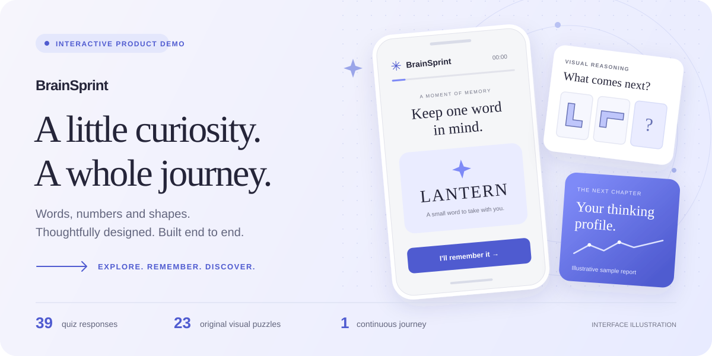
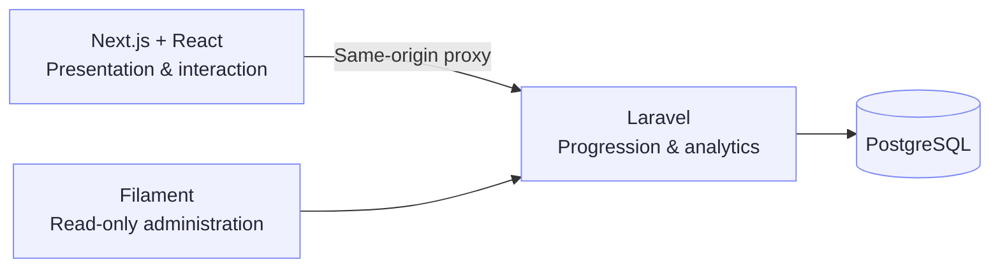

<p align="center">
  
</p>

<h1 align="center">BrainSprint</h1>

<p align="center">
  A mobile-first challenge experience, built from the first interaction to the final report.<br />
  Original puzzles. Persistent progress. A full-stack product you can explore.
</p>

<p align="center">
  <a href="https://brainsprint-voprosovnety.vercel.app"><strong>Try the live demo ↗</strong></a>
  &nbsp; · &nbsp;
  <a href="https://brainsprint-voprosovnety.vercel.app/demo-analytics"><strong>Explore demo analytics ↗</strong></a>
  &nbsp; · &nbsp;
  <a href="#run-locally">Run locally</a>
</p>

<p align="center">
  
  
  
  
  
  
</p>

## Small details. A complete experience.

BrainSprint takes visitors through word memory, number recall and visual reasoning, then builds an illustrative report and a simulated checkout journey. Behind the interface, Laravel manages progression, persistence and analytics.

| Made for the visitor | Built into the system |
| :--- | :--- |
| **39 quiz responses**, including 23 original visual puzzles | **Versioned journeys** — each run stays pinned to its published configuration |
| **Pick up where you left off** after a refresh, with retryable answers | **Transactional saves** — repeated submissions do not duplicate milestones or results |
| **Keyboard controls, visible focus and reduced motion** | **Session-based ownership**, server validation, CSRF protection and rate limits |
| **A sample report, mock checkout and two guide outcomes** | **Shared analytics logic** for public synthetic data and authenticated administration |

## Inside the journey

<p align="center">
  
  
</p>

**Remember a word → Solve the challenges → Explore a sample report → Try the mock offers**

One task per screen, original SVG artwork and a calm lavender palette keep the experience focused. Upcoming artwork is preloaded; failed saves retain the selected answer for retry.

> **About the demo** · An entertainment experience with illustrative reports, independent of answer correctness. It does not measure IQ or cognitive ability. All prices, checkouts and subscriptions are simulated; no payments are collected.

## Behind the interface



- **Clear responsibilities.** Next.js owns presentation and interaction; Laravel owns configuration, transitions, reports and analytics. Filament provides separately authenticated, read-only administration.
- **Useful analytics.** Server milestones are deduplicated. Public dashboards expose labeled synthetic aggregates; ordinary analytics exclude synthetic data.
- **Visitor control.** Email is optional and unused for marketing or delivery. Visitors can delete their journey and start again; inactive data is eligible for cleanup after 30 days.

The hosted demo runs on **Vercel + Neon**. npm and Composer dependencies are pinned in committed lockfiles.

## Run locally

<details>
<summary><strong>Setup, start commands and local administration</strong></summary>

<br />

**Requirements:** Node.js 24, PHP 8.3–8.5 with PDO PostgreSQL, mbstring, curl, XML and zip, and Docker with Compose v2. Keep ports 3000, 8008 and 55432 available.

From the repository root:

```sh
./infra/setup.sh
```

Setup installs locked dependencies and project-local Composer, creates missing environment files and secrets, starts PostgreSQL, applies migrations and publishes the funnel configuration. Existing secrets and data are preserved.

Start the API:

```sh
cd apps/api
php artisan serve --no-reload --host=127.0.0.1 --port=8008
```

Restart the API after changing its environment file. `--no-reload` keeps the configured environment available to the development server.

In another terminal, from the repository root:

```sh
npm run dev --prefix apps/web
```

Open **[127.0.0.1:3000](http://127.0.0.1:3000)**. Use `127.0.0.1` consistently; `localhost` has separate cookies.

**Optional: administration and sample analytics**

From the repository root:

```sh
php apps/api/artisan admin:local reviewer@brainsprint.local
php apps/api/artisan analytics:seed-demo
```

Local access details are saved to the private `.local/admin-access.json` file. Repeating the administrator command rotates the password; there are no default credentials. Open [administration](http://127.0.0.1:8008/admin) or [demo analytics](http://127.0.0.1:3000/demo-analytics).

The analytics seed appends labeled synthetic scenarios, preserving real visits. Repeating it for the same UTC date is a no-op; use `--date=YYYY-MM-DD` for a historical anchor.

**Stopping and updating**

Stop application servers with Ctrl-C. Stop PostgreSQL while preserving data:

```sh
docker compose --env-file apps/api/.env -f infra/compose.yaml down
```

Run setup again to resume PostgreSQL. After schema or funnel changes, run `php artisan migrate` and `php artisan db:seed` from `apps/api`. Publication affects new visitors; existing journeys retain their configuration.

</details>

## Explore the implementation

| Guide | What it covers |
| :--- | :--- |
| [Architecture](docs/ARCHITECTURE.md) | Application boundaries, persistence and interaction decisions |
| [Consumer API](contracts/README.md) · [V3 behavior](contracts/V3.md) · [OpenAPI](contracts/openapi.json) | Requests, validation and journey contracts |
| [Analytics](docs/ANALYTICS.md) | Events, cohorts and metric definitions |
| [Deployment](docs/DEPLOYMENT.md) | Runtime configuration, releases, backups, retention and rollback |

<details>
<summary><strong>Automated checks and coverage</strong></summary>

GitHub Actions defines PostgreSQL regression tests, a production frontend build and TypeScript checks. The v3 API suites cover full journey progression, both guide outcomes, immutable retries, private report access, configuration publication, ownership and analytics. Shared suites cover administration, retention and cache boundaries. These automated checks do not establish browser or visual acceptance.

Local tests must use the isolated `brainsprint_test` database. Helpers live in `apps/api/tests/` and `infra/checks/`; see [production-package checks](docs/DEPLOYMENT.md#reproduce-the-local-production-package-check) for the release fixture.

</details>
